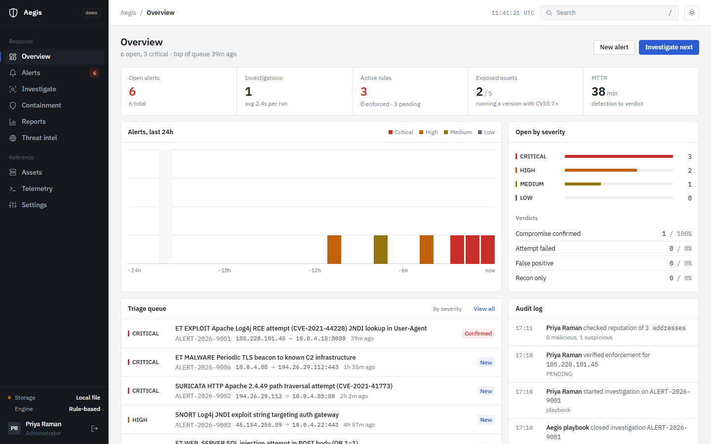
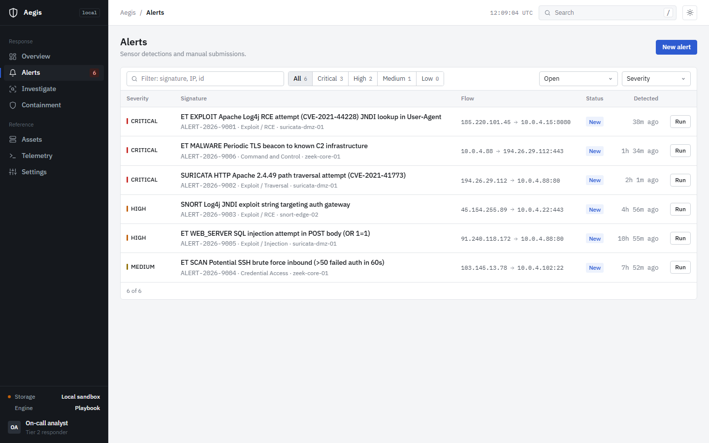
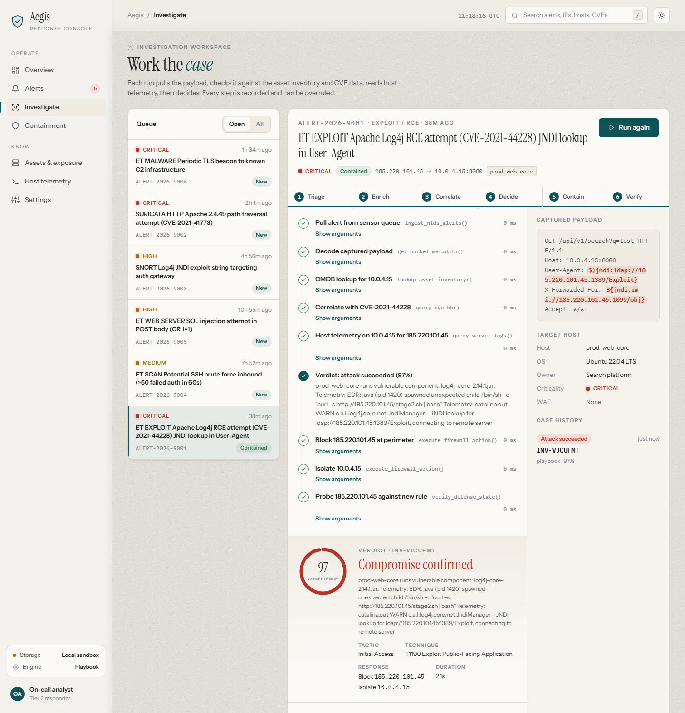
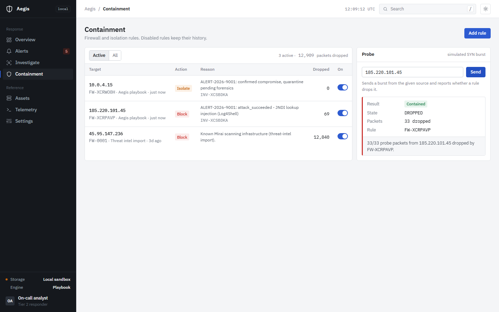
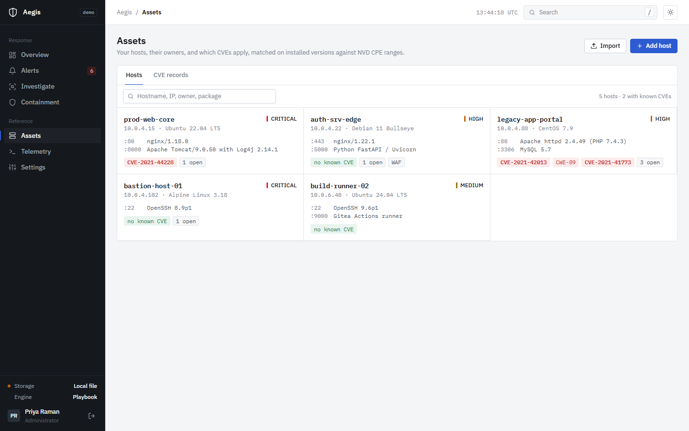
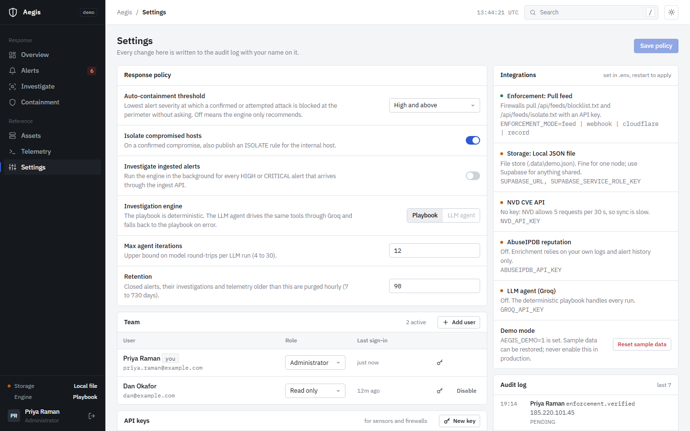
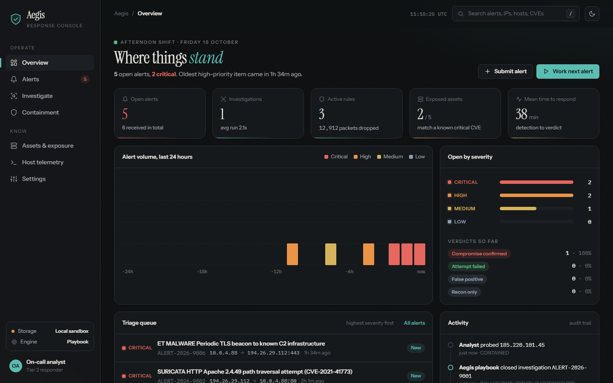

# Aegis Security

An incident response console for a small SOC. Aegis takes IDS alerts from your sensors and works out whether each attack actually landed. It checks the target against your asset inventory and against NVD CVE data, matched by CPE version range, and reads the host's own logs for the attacker's address. It then records a verdict and pushes a containment rule to your firewall, and reports whether the firewall actually picked the rule up.

Express on Node, with Supabase Postgres or a local file for storage. There is no build step.



## How it works

```
 Suricata / Zeek / any IDS --POST /api/ingest/alerts-->  +--------+  --feed / webhook / Cloudflare-->  firewall
 nginx, auth, EDR logs     --POST /api/ingest/logs---->  | Aegis  |  <--GET /api/feeds/blocklist.txt-- (pull)
 CMDB / scanner export     --Assets > Import---------->  +--------+  <--NVD CVE API 2.0 (CPE ranges, CISA KEV)
```

Every investigation runs six phases, streamed live to the console:

| Phase | What happens |
| --- | --- |
| Triage | Load the alert and classify the payload (JNDI, traversal, SQLi, brute force, beaconing) |
| Enrich | Find the target in the inventory and test its installed versions against NVD CPE ranges. Optionally check the source IP on AbuseIPDB |
| Correlate | Read the target's ingested HTTP, auth and EDR logs for the attacker's address |
| Decide | Weigh exposure against host evidence and record a verdict with confidence and a MITRE mapping |
| Contain | Create a BLOCK rule for the source, and an ISOLATE rule for the host when compromise is confirmed |
| Verify | Read the rule back from the enforcement backend: `ENFORCED`, `PENDING`, `FAILED` or `RECORDED` |

Aegis never marks an alert *contained* until the backend has confirmed the rule. A rule that is only published shows as `PENDING`, and one the firewall rejected shows as `FAILED`. Both appear under Containment > Needs attention.

The **playbook** engine is deterministic and needs no API key. The optional **LLM agent** drives the same tools through Groq tool calling, so it cannot do anything the playbook cannot. It falls back to the playbook if the model errors.

## Screens

| | |
| --- | --- |
|  |  |
| Alert queue with severity filters | Live investigation timeline, verdict and report |
|  |  |
| Rules with enforcement read-back | Inventory and NVD-backed CVE records |
|  |  |
| Team, API keys, integrations, policy | Dark theme |

## Quick start

Requires Node 18 or newer.

```bash
npm install
cp .env.example .env      # optional: fill in what applies
npm start
```

Open http://localhost:3000. On first run the console asks you to create the administrator account. On a host other people can reach, set `AEGIS_SETUP_TOKEN` first: the setup screen then asks for it, so nobody else can claim the account before you do.

A fresh install is empty, with no alerts, hosts or CVEs. To try it with sample incidents, start with `AEGIS_DEMO=1`, ideally against a throwaway file:

```bash
AEGIS_DEMO=1 AEGIS_DATA_FILE=.data/demo.json npm start
```

## Connecting your environment

### 1. Inventory

Assets > Add host, or Assets > Import with a CSV or JSON export from your CMDB or scanner. Columns:

```
ip_address,hostname,os_version,owner,criticality,waf_enabled,services,installed_packages
10.20.0.5,web-01,Ubuntu 22.04,Payments,HIGH,true,"443/nginx 1.24.0; 22/OpenSSH 8.9p1",log4j-core-2.17.1.jar
```

Include versions. Exposure comes from comparing them against NVD CPE version ranges, so `log4j-core-2.14.1` is exposed to CVE-2021-44228 and `2.17.1` is not.

### 2. CVE records

Assets > CVE records > Add from NVD fetches a CVE by id: CVSS, CWE, CPE ranges, references and the CISA KEV flag. Sync from NVD refreshes every record. Without `NVD_API_KEY`, NVD allows 5 requests per 30 seconds, and Aegis paces itself to match.

### 3. Sensor alerts

Create an API key with the `ingest` scope under Settings > API keys. The key is shown once, with ready-to-paste commands. Aegis accepts Suricata EVE JSON as NDJSON, a JSON array, or `{"events": [...]}`, up to 5000 events per request. Non-alert EVE records are skipped, and events that were already sent are de-duplicated.

```bash
# Stream Suricata alerts as they happen
tail -F /var/log/suricata/eve.json | grep --line-buffered '"event_type":"alert"' | \
  while read -r line; do printf '%s\n' "$line" | curl -sS -X POST https://aegis.example.com/api/ingest/alerts \
    -H "Authorization: Bearer $AEGIS_KEY" -H "Content-Type: application/x-ndjson" --data-binary @-; done
```

For production, ship with Filebeat or Vector rather than a shell loop. Use an HTTP output to `/api/ingest/alerts` with the bearer header and `application/x-ndjson`. Other IDSs can send generic JSON with `signature`, `severity`, `source_ip`, `dest_ip`, `dest_port`, `payload` and `timestamp`. The response reports `{accepted, duplicates, skipped, rejected}` with a reason for each rejected line.

Enable Settings > Investigate ingested alerts to triage every HIGH or CRITICAL alert automatically.

### 4. Host logs

The Correlate phase can only find evidence you have shipped:

```bash
curl -sS -X POST "https://aegis.example.com/api/ingest/logs?host_ip=10.20.0.5&log_type=http_access" \
  -H "Authorization: Bearer $AEGIS_KEY" -H "Content-Type: text/plain" --data-binary @/var/log/nginx/access.log
```

The log types are `http_access`, `auth_log`, `edr_process` and `system`. Plain lines, NDJSON and JSON arrays are all accepted. When `log_type` is left out, Aegis infers it from the line's format.

### 5. Enforcement

Set `ENFORCEMENT_MODE` in `.env`:

| Mode | How rules reach the firewall | When a rule counts as ENFORCED |
| --- | --- | --- |
| `feed` (default) | Firewall pulls `/api/feeds/blocklist.txt` and `/api/feeds/isolate.txt` | After the firewall's next pull |
| `webhook` | `POST` to `ENFORCEMENT_WEBHOOK_URL` for each create or remove | When the receiver answers 2xx |
| `cloudflare` | IP Access Rule on `CF_ZONE_ID` (BLOCK only) | When the rule reads back as `mode=block` |
| `record` | Nowhere. Rules are stored for you to apply by hand | Never; shown as RECORDED |

**Pull feed.** Create a key with the `feed` scope. The feed is plain text, one address per line. Firewalls that only support basic auth can use any username, with the key as the password.

- PAN-OS: Objects > External Dynamic Lists, type IP List, source the blocklist URL, then reference the EDL in a deny policy.
- FortiGate: Security Fabric > External Connectors > Threat Feeds > IP Address, then use it in a deny policy.
- pfSense / OPNsense: Firewall > Aliases, type URL Table (IPs), then use the alias in a block rule.

**Webhook.** The body is `{"event": "rule.created" | "rule.removed", "sent_at", "rule": {rule_id, action, target_ip, ip_version, reason, enacted_by, investigation_id}}`. When `ENFORCEMENT_WEBHOOK_SECRET` is set, each request carries `X-Aegis-Timestamp` and `X-Aegis-Signature: sha256=<hex>`, an HMAC-SHA256 of `"<timestamp>.<raw body>"`. Verify it and reject old timestamps:

```js
const expected = 'sha256=' + crypto.createHmac('sha256', secret).update(`${req.get('x-aegis-timestamp')}.${rawBody}`).digest('hex');
const fresh = Math.abs(Date.now() / 1000 - Number(req.get('x-aegis-timestamp'))) < 300;
if (!fresh || !crypto.timingSafeEqual(Buffer.from(expected), Buffer.from(req.get('x-aegis-signature')))) return res.sendStatus(401);
```

Reply `{"status": "failed", "detail": "..."}` to mark the rule FAILED, or `{"id": "..."}` to record the remote id.

**Cloudflare.** Create an API token with *Zone > Firewall Services > Edit*, and set `CF_API_TOKEN` and `CF_ZONE_ID`. ISOLATE rules are recorded only, because the edge cannot quarantine an internal host.

## Users and roles

| Role | Can |
| --- | --- |
| Administrator | Everything: users, API keys, policy, CVE sync |
| Analyst | Investigate, override verdicts, create and toggle rules, edit inventory |
| Read only | View everything, change nothing |

Passwords are hashed with scrypt. Sessions are HMAC-signed, HttpOnly, SameSite=Strict cookies that last 12 hours. Changing a password or role, or disabling a user, ends that user's other sessions at once. Cookie-authenticated writes must carry an `X-Aegis-Client` header, which blocks cross-site form posts. API keys are stored as SHA-256 hashes and scoped to `ingest` or `feed`. Login attempts are rate limited, and failed sign-ins are written to the audit log. Behind HTTPS, set `COOKIE_SECURE=1`. Behind a reverse proxy, also set `TRUST_PROXY`.

## Supabase backend

With the Supabase CLI:

```bash
npx supabase login
npx supabase projects create aegis-security --org-id <org> --region ap-south-1 --db-password <pw>
npx supabase link --project-ref <ref>
npx supabase db push                                   # applies every file in supabase/migrations
npx supabase projects api-keys --project-ref <ref> --reveal
```

Put the project URL (`https://<ref>.supabase.co`) in `SUPABASE_URL` and the `sb_secret_...` key (or the legacy `service_role` JWT) in `SUPABASE_SERVICE_ROLE_KEY`, then restart. The startup banner and Settings > Integrations show `Supabase Postgres` when it is in use. The SQL editor or the Supabase MCP `apply_migration` tool work too; apply the migrations in filename order.

Row level security is on for every table, with no policies, and the third migration revokes table privileges from `anon` and `authenticated` outright, so a leaked publishable key reads nothing. Only the server, holding the secret key, has access. If Supabase is configured but unreachable, the server refuses to start rather than quietly writing incidents to a local file. Set `AEGIS_ALLOW_FALLBACK=1` if you would rather it fall back.

To let a coding agent manage the project, add Supabase's hosted MCP server (`https://mcp.supabase.com/mcp`, OAuth sign-in) to the agent's MCP config.

## Deploying on Vercel

`server.js` exports the Express app, so Vercel runs it as one function with zero config; `npm start` still runs it as a normal server. Files in `public/` are served from Vercel's CDN with the headers in `vercel.json`.

Set these in Project Settings > Environment Variables, then redeploy:

| Variable | Value |
| --- | --- |
| `SUPABASE_URL`, `SUPABASE_SERVICE_ROLE_KEY` | Required. Without them each instance keeps data in `/tmp` and loses it on cold start. |
| `SESSION_SECRET` | 32+ random characters. Required: instances do not share a generated one. |
| `AEGIS_SETUP_TOKEN` | Asked for on the first-run screen, so nobody else claims the admin account. |
| `COOKIE_SECURE=1`, `TRUST_PROXY=1`, `NODE_ENV=production` | Vercel serves HTTPS behind one proxy hop. |
| `CRON_SECRET` | Vercel Cron sends it to `/api/cron/retention` (daily, 03:00 UTC). |

Rate limits are kept per function instance, so they are looser on Vercel than on a single server. Investigations stream over one request; a long LLM run is bounded by the function's max duration.

## What Aegis does not do for you

- It does not capture traffic. Alerts come from your IDS, and evidence comes from the logs you ship. A host that sends no logs gets a lower-confidence verdict.
- It does not touch your firewall directly. It publishes rules through one of the four modes above, and the firewall has to be configured to consume them.
- CVE data comes from NVD. Records are only as current as your last sync, and CPE matching is only as good as the versions in your inventory.
- Retention purges closed alerts, their investigations and telemetry older than the configured window, every hour. Open alerts are never purged.

## API

Browser endpoints use the session cookie. Ingest and feed endpoints use `Authorization: Bearer <key>`.

| Method | Path | Purpose |
| --- | --- | --- |
| GET | `/api/health` | Storage, enforcement, intel and engine status |
| GET / POST | `/api/auth/state`, `/setup`, `/login`, `/logout`, `/password` | Sessions |
| GET / POST / PATCH | `/api/users`, `/api/users/:id` | Team management (admin) |
| GET / POST | `/api/keys`, `/api/keys/:id/revoke` | API keys (admin) |
| POST | `/api/ingest/alerts`, `/api/ingest/logs` | Sensor ingest (`ingest` key) |
| GET | `/api/feeds/blocklist.txt`, `/api/feeds/isolate.txt` | Firewall feeds (`feed` key) |
| GET / POST | `/api/alerts`, `/api/alerts/:id/status` | Alert queue |
| POST | `/api/investigations/stream` | Run an investigation (server-sent events) |
| POST | `/api/investigations/:id/override` | Override a verdict; containment follows |
| GET / POST | `/api/rules`, `/rules/:id/toggle`, `/rules/:id/verify`, `/api/verify` | Containment and read-back |
| GET / POST / PUT / DELETE | `/api/assets`, `/api/assets/:ip`, `/api/assets/import` | Inventory |
| GET / POST / DELETE | `/api/cves`, `/api/cves/:id`, `/api/cves/sync` | NVD-backed CVE records |
| GET | `/api/logs`, `/api/audit`, `/api/search`, `/api/overview` | Read models |
| GET / PUT | `/api/config` | Response policy |

## Tests

```bash
npm test
```

There are three suites. Unit tests cover CPE version matching, EVE normalisation, password hashing and webhook signatures. The smoke test runs every sample incident through the playbook against each enforcement adapter. The HTTP suite makes about 40 end-to-end checks: auth, roles, CSRF, ingest and de-duplication, feeds, CSV import, enforcement read-back and retention. External APIs (NVD, AbuseIPDB, Cloudflare) are stubbed or exercised offline.

To run the HTTP suite against the Supabase project in `.env` instead of a temp file, set `AEGIS_TEST_SUPABASE=1`. It empties every Aegis table before and after the run, so use a staging project, never one holding real incidents.

To regenerate the screenshots or the walkthrough video, start a demo server (`AEGIS_DEMO=1 AEGIS_DATA_FILE=.data/demo.json npm start`), then run `npm run screenshots` or `node demo_video/record_demo.js`. Both need `npx playwright install chromium`.

## Project layout

```
server.js               boot: store, enforcer, intel clients, banner
src/app.js              HTTP hardening, sessions, auth, users, API keys
src/routes.js           console API, ingest, feeds, retention
src/engine/             analysis rules, tools, playbook and LLM investigator
src/enforce/            record / feed / webhook / Cloudflare adapters
src/ingest/             EVE, generic alert, log and CSV normalisation
src/intel/              NVD CVE API 2.0 client, AbuseIPDB
src/security/           scrypt, signed sessions, API keys, rate limits
src/store/              Supabase and local file backends
supabase/migrations/    Postgres schema
public/                 single-page console (ES modules, no build step)
test/                   unit, smoke and HTTP suites
```

## License

MIT. See `LICENSE`.