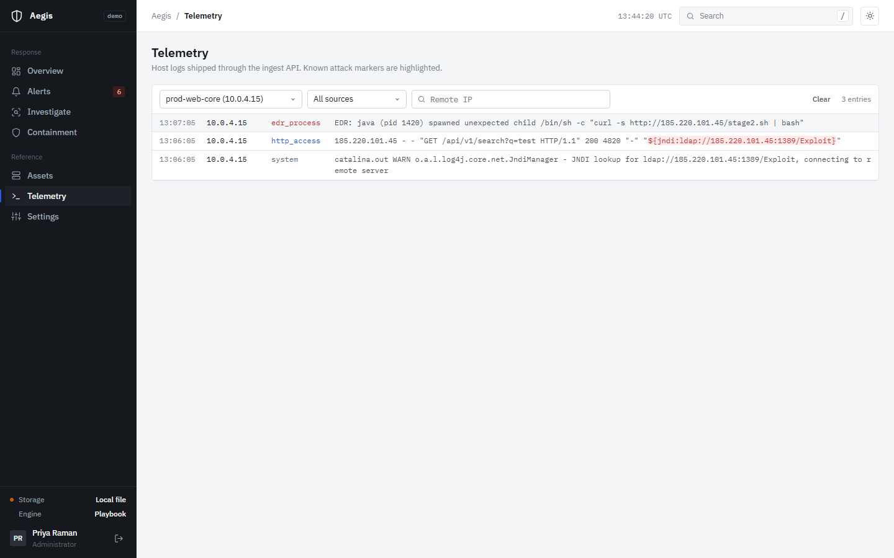

# Aegis Security

An incident response console for a small SOC. It takes a network IDS alert and works out whether the attack actually landed. It pulls evidence from the asset inventory, the CVE knowledge base and the target host's logs, reaches a verdict, and contains the source when the attack succeeded. An analyst can override any verdict, and containment follows the override.

The backend is Express on Node, with Supabase (Postgres) for storage. If Supabase is not configured, the server runs against a local file sandbox, so it works out of the box.


## What it does

Most IDS alerts are noise. A Log4j signature firing against a Python service is not a compromise. A Log4j signature firing against an unpatched Java app, followed by an outbound connection from that host, is one. Aegis runs the same checks an analyst would, in the same order, and shows its work.

Every investigation goes through six phases. The console streams each one live:

| Phase | What happens | Tools |
| --- | --- | --- |
| Triage | Load the alert and classify the payload (JNDI, traversal, SQLi, brute force, beaconing) | `ingest_nids_alerts`, `get_packet_metadata` |
| Enrich | Look up the target in the CMDB and match its software against known CVEs | `lookup_asset_inventory`, `query_cve_kb` |
| Correlate | Read the host's HTTP, auth and EDR logs for the attacker's IP | `query_server_logs` |
| Decide | Weigh exposure against host evidence and record a verdict with confidence and MITRE mapping | `record_investigation_verdict` |
| Contain | Block the source IP, or isolate the host if the compromise is confirmed | `execute_firewall_action` |
| Verify | Probe the perimeter to confirm the block holds | `verify_defense_state` |

There are two engines:

- **Playbook** (the default) is deterministic and needs no API key. It gives the same answer on every run, which suits demos and tests.
- **LLM agent** is optional. It uses Groq tool calling with the same eight tools, so it cannot do anything the playbook cannot. Set `GROQ_API_KEY` to enable it, then pick it in Settings or per case.

## Screens

| | |
| --- | --- |
|  |  |
| Alert queue with severity filters and a detail drawer | Live investigation timeline, verdict and report |
|  |  |
| Firewall rules and a perimeter probe | Hosts and the vulnerability knowledge base |
|  |  |
| Host log search | Dark theme |

Other things worth knowing:

- Press `/` or `Ctrl+K` anywhere to search alerts, hosts, CVEs and rules.
- The theme follows your OS until you toggle it.
- Each finished case produces a markdown incident report you can copy straight into a ticket.

## Quick start

Requires Node 18 or newer.

```bash
npm install
npm start
```

Open http://localhost:3000. With no configuration the server keeps its data in `.data/sandbox.json`. To start over, use Settings > Reset demo data.

## Supabase backend

1. Create a project at https://supabase.com.
2. Apply the schema in `supabase/migrations/20261016000000_aegis_schema.sql`. Use whichever of these suits you:
   - **SQL editor:** paste the file into the project's SQL editor and run it.
   - **Supabase CLI:** run `supabase link --project-ref <ref>`, then `supabase db push`.
   - **Supabase MCP:** ask your agent to run `apply_migration` with the file's contents.
3. Copy `.env.example` to `.env` and fill in `SUPABASE_URL` and `SUPABASE_SERVICE_ROLE_KEY` (Project settings > API).
4. Restart the server. On first boot it seeds the tables. The startup banner and the sidebar both show `Supabase` as the storage backend.

Row level security is enabled on every table, and no policies are defined. The anon key can read nothing; only the server, using the service role key, can access the data. Keep that key on the server and never ship it to a browser.

If the credentials are set but the project is unreachable or the migration has not been applied, the server logs a warning and falls back to the local sandbox. It does not fail every request. Settings > Storage shows which backend is active and why.

### Connecting the Supabase MCP server

To let an AI coding agent manage the project directly (apply migrations, run SQL, read logs), add the official MCP server to your agent's config:

```json
{
  "mcpServers": {
    "supabase": {
      "command": "npx",
      "args": ["-y", "@supabase/mcp-server-supabase@latest", "--project-ref=<your-project-ref>"],
      "env": { "SUPABASE_ACCESS_TOKEN": "<personal-access-token>" }
    }
  }
}
```

Create the access token under Account > Access tokens. Add `--read-only` once the schema is in place if you only want the agent to read.

## Seeded scenarios

The seed data covers the common outcomes, and the cases are related: 9006 is follow-on activity from 9002.

| Alert | Scenario | Expected verdict |
| --- | --- | --- |
| ALERT-2026-9001 | Log4Shell JNDI against Tomcat with log4j 2.14.1; Java then spawns a shell that fetches a second stage | Attack succeeded: source blocked, host isolated |
| ALERT-2026-9002 | Path traversal against Apache httpd 2.4.49; httpd runs `id` and `uname` | Attack succeeded: source blocked, host isolated |
| ALERT-2026-9003 | Log4j payload against a FastAPI (Python) service with no Java on the box | False positive, no action |
| ALERT-2026-9004 | SSH password spray against the bastion; every attempt fails and fail2ban bans the source | Attack failed, source blocked |
| ALERT-2026-9005 | sqlmap against a PHP login that uses prepared statements | Attack failed, source blocked |
| ALERT-2026-9006 | 60-second TLS beacon from the portal, which was compromised in 9002, to the same attacker | Attack succeeded: C2 blocked, host isolated |

You can also submit your own alert from the Alerts page.

## API

All endpoints are JSON under `/api`.

| Method | Path | Purpose |
| --- | --- | --- |
| GET | `/health` | Storage backend, engine and uptime |
| GET | `/overview` | KPIs, 24h volume, severity and verdict breakdown |
| GET | `/alerts` | List alerts (`severity`, `status`, `q`) |
| GET | `/alerts/:id` | Alert with its asset and investigations |
| POST | `/alerts` | Submit an alert |
| POST | `/alerts/:id/status` | Change alert status |
| POST | `/investigations/stream` | Run an investigation, streamed as server-sent events |
| GET | `/investigations` | List investigations |
| GET | `/investigations/:id` | One investigation with its steps |
| POST | `/investigations/:id/override` | Analyst override; reconciles containment |
| GET / POST | `/rules` | List or create firewall rules |
| POST | `/rules/:id/toggle` | Enable or disable a rule |
| POST | `/probe` | Perimeter probe for an IP |
| GET | `/assets`, `/cves`, `/logs` | Inventory, knowledge base, host logs |
| GET | `/search` | Global search used by the command palette |
| GET / PUT | `/config` | Policy and engine settings |
| GET | `/audit` | Audit trail |
| POST | `/reset` | Restore the seed data |

## Tests

```bash
npm test
```

This runs every seeded alert through the playbook against an isolated in-memory store. It checks each verdict and final status, and that containment rules were written.

To regenerate the screenshots, keep `npm start` running and run `npm run screenshots`. To record a walkthrough video, run `node demo_video/record_demo.js`. The script needs Playwright's Chromium (`npx playwright install chromium`).

## Project layout

```
server.js                 Express app and API routes
src/engine/               analysis rules, tools, playbook and LLM investigator
src/store/                storage interface, Supabase and local sandbox backends
src/seed.js               demo telemetry
supabase/migrations/      Postgres schema
public/                   single-page console (no build step)
  css/                    tokens, layout, components, views
  js/views/               one module per screen
test/smoke.js             end-to-end playbook test
scripts/screenshots.js    README screenshots
```

## License

MIT. See `LICENSE`.